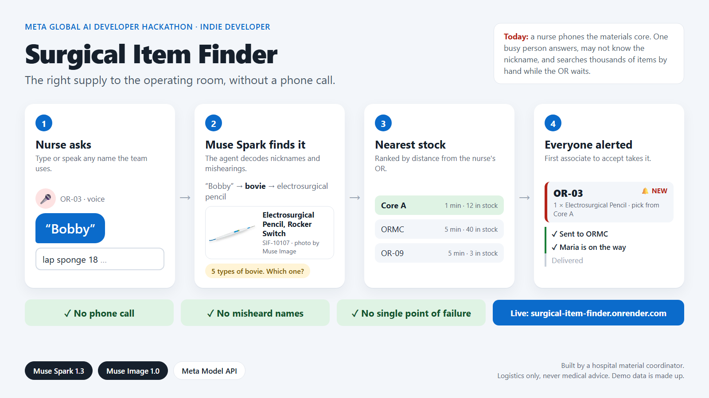

# Surgical Item Finder

**An AI agent that gets the right surgical supply to the operating room, without a phone call.**



Built solo for the **Meta Global AI Developer Hackathon** (Oct 26 to Nov 4, 2026) · Track: **Indie Developer** · Theme: **Build for Your World**

### Live demo: https://surgical-item-finder.onrender.com

> Free hosting: if the site has been idle, the first visit takes about a minute to wake up.

---

## The problem

During surgery, when a nurse needs an item, they call or message the ORMC (Operating Room Materials Core) on a VoLTE phone. Then:

- The one associate they reach may be busy, away, or covering several jobs.
- There are thousands of items, and surgical teams often use different names for the same one.
- If the associate doesn't recognize the name, they search the inventory app by hand, or need the item number.

Every minute spent on the phone is a minute lost in the operating room.

## Why I built this

I work as a material coordinator in a hospital, so I see this problem every day: an urgent call from the OR, a nickname that doesn't match the catalog, and a hand search through thousands of items while the surgical team waits. This app is what I want that moment to look like.

## The solution

1. The nurse picks their OR, then **types or speaks** the item name, using whatever name they know: "bovie", "lap sponge", or a misheard "Bobby".
2. A **Muse Spark agent** works out which item they mean and shows a **packaging-style photo**, the item number, and **where it's in stock**, ranked from nearest: the same OR, the OR's core, the ORMC, then other ORs.
3. The nurse adds items to a **cart**, sets quantities, reviews, and chooses:
   - **Deliver from ORMC:** every ORMC associate's screen **beeps at once**. The first to tap **Accept** gets it; others see it's taken.
   - **I'll pick it myself:** no alert, just a pick list with locations. The request is still recorded.
4. The nurse's screen updates live: **Sent → Maria is on the way → Delivered ✓**.
5. **Not something we stock?** The agent looks the description up in the **FDA's public device database** and shows real products: maker, model number, whether it's still sold, and any recalls. One tap asks ORMC to source it.

No phone call, no misheard names, and no single point of failure.

## Try it in 2 minutes

1. **Nurse** (phone or browser): open the [live demo](https://surgical-item-finder.onrender.com), choose an OR, and search **"Bobby"** or tap 🎤 and say it. The agent asks which type of bovie you mean.
2. Add one or two items to the cart, then tap **Deliver from ORMC → Confirm**.
3. **ORMC associate** (a second window or device): open [/ormc](https://surgical-item-finder.onrender.com/ormc), enter a name, and tap **Start shift**. The request appears with a beep.
4. Tap **Accept**, then **Delivered**, and watch the nurse's screen update.
5. Search **"tourniquet cuff"**, which isn't in the demo catalog. You'll see real FDA-listed products with "Still sold" and recall badges, and an **Ask ORMC to source this** button. The first FDA lookup can take several seconds.

Tip: open `/ormc` in two windows with different names (use a private window for the second) to see "first to accept wins".

## What it is not

This is a **supply logistics tool**. It does not give medical advice and never suggests which item to use. The surgical team decides what they need; the app only finds it and gets it delivered. The agent's instructions forbid clinical advice.

## How the agent works

Muse Spark 1.3 runs as a **tool-calling agent** (via the OpenAI-compatible Meta Model API):

| Tool | What it does |
|---|---|
| `find_item` | Searches the catalog by name, nickname, item number or manufacturer part number (MPN). The agent can call it several times with different wording, e.g. after working out what a nickname or misheard word likely means |
| `lookup_fda_devices` | Only when the catalog has nothing that fits: searches the [openFDA](https://open.fda.gov/apis/device/) device database by description and checks each product for recalls. If an FDA model number matches an MPN we stock, the agent goes straight to our item |
| `answer` | Ends the turn with one of: **match**, **clarify** (asks which one, e.g. 5 kinds of bovie), **not in catalog** (shows the FDA products), or **not found** |

Guard rails:
- **No made-up items:** every item number the model returns is checked against the catalog, and anything it didn't actually find is dropped.
- **No made-up products:** FDA products shown to the nurse come only from the lookup tool's results, never from the model's own text.
- **No dead ends:** if the model gives up without trying the FDA lookup, the app runs it anyway.
- **Step limit:** at most 6 model calls per search.
- **Always works:** if the model is slow, errors, or isn't configured, the app falls back to plain search, so a nurse is never stuck. FDA lookups time out after 8 seconds and are cached, so a slow government site never freezes the app.

After the agent picks the item, regular code handles the rest: **stock ranking** (enough stock first, then distance from the nurse's OR), **requests** stored in SQLite (including "source this" requests for items we don't stock), and **first-to-accept** enforced by a single conditional database update, so two associates can't both win.

**Muse Image 1.0** generated the item photos in a packaging style, so ORMC associates without clinical training can spot the right box on the shelf.

## Tech

| Part | Built with |
|---|---|
| AI | Muse Spark 1.3 (agent), Muse Image 1.0 (photos), Meta Model API |
| Outside data | openFDA device and recall APIs (free, no key) |
| Backend | Python, FastAPI, Pydantic, SQLite |
| Frontend | React 18, Vite, browser speech recognition, Web Audio alerts |
| Hosting | Docker on Render |
| Tests | pytest, 104 tests (models, search, agent with a fake model, FDA lookup with fake data, stock ranking, requests, API). No test calls the internet |

The inventory sits behind an `InventoryAdapter` interface, so a real hospital system could replace the demo JSON catalog without touching the agent or the screens.

## Run it locally

```bash
python3 -m venv .venv && source .venv/bin/activate
pip install -r requirements-dev.txt
cp .env.example .env            # then put your Meta Model API key in .env
cd frontend && npm install && npm run build && cd ..
uvicorn app.main:app --app-dir backend --reload
```

Open http://localhost:8000 (nurse) and http://localhost:8000/ormc (associate). Run tests with `pytest`.

## Roadmap (built during the hackathon)

All code, data and assets in this repo were created during the event. Each day's work is in the commit history.

- [x] **Day 1, Oct 30:** README, roadmap, project setup, made-up catalog of 286 surgical items with nicknames and stock across 15 locations
- [x] **Day 2, Oct 31:** Item search and the Muse Spark agent with the `find_item` tool
- [x] **Day 3, Nov 1:** Voice input, stock lookup and nearest-location ranking
- [x] **Day 4, Nov 2:** Nurse screen: item photos, cart, review and submit
- [x] **Day 5, Nov 3:** ORMC screen with live alerts, Accept and Delivered; live status for the nurse; deployed live demo
- [x] **Day 6, Nov 4:** Redesigned screens; FDA device lookup with recall badges for items we don't stock, and "Ask ORMC to source this"; demo video and submission
- [ ] **Next:** Muse supply insights: use the history of every request (delivered, self-picked or sourced) to flag high-use items and suggest restocking before they run out
- [ ] **Next:** Searches that found nothing are logged, and Muse suggests which catalog item each one meant, so the catalog learns the hospital's own nicknames
- [ ] **Later:** live supplier stock and backorder status, which needs distributor accounts

## Data and rights

All inventory data is **made up for this demo**. No real hospital or patient data is used. All item images were generated for this project with Muse Image 1.0.

Product, distribution and recall details for items we don't stock come live from the FDA's public openFDA API. As the FDA notes, this data is not validated for medical decisions, so the app uses it only to help ORMC identify and source a product.

## Credits

- Meta AI models: Muse Spark 1.3 (agent) and Muse Image 1.0 (item photos), via the Meta Model API
- Device and recall data: [openFDA](https://open.fda.gov/), U.S. Food and Drug Administration

## License

MIT, see [LICENSE](LICENSE).
